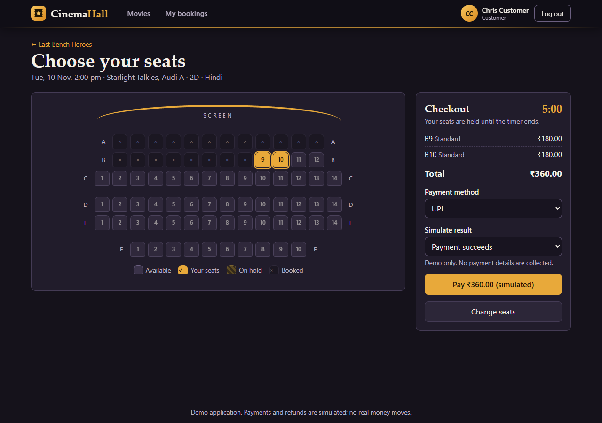
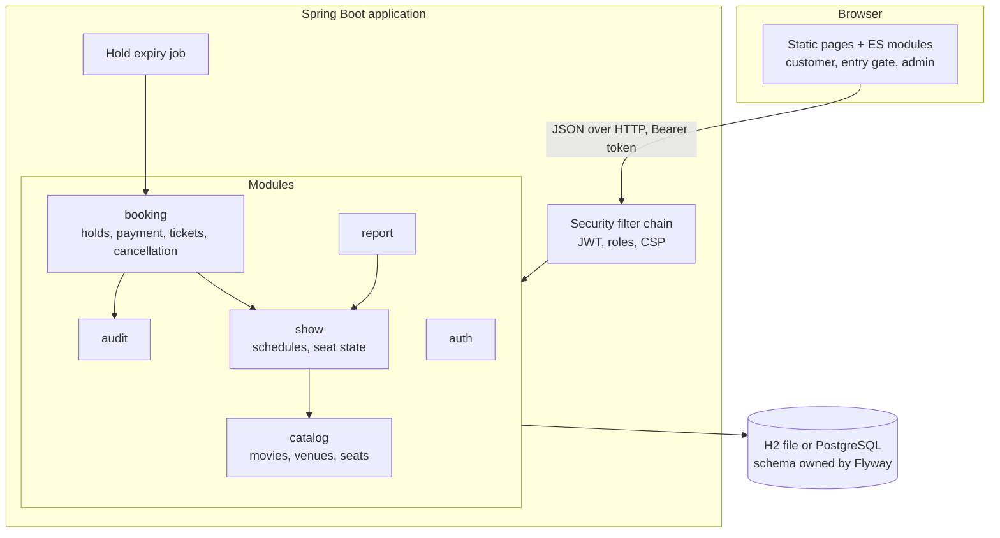

# Cinema Hall Ticket Booking System

A full-stack web application for running a cinema: customers browse movies, reserve seats with a timed hold, pay (simulated) and receive a QR ticket; staff validate tickets at the door; admins manage the catalogue and schedules and read occupancy and sales reports.

**Stack:** Java 21, Spring Boot 3.5, Spring Security (JWT), Spring Data JPA, Flyway, H2 or PostgreSQL, and a frontend in plain HTML, CSS and JavaScript.



## Run it

You need **JDK 21**. Nothing else has to be installed: the Maven wrapper downloads Maven, and the default database is a local file.

```bash
./mvnw spring-boot:run        # Windows: mvnw.cmd spring-boot:run
```

Open <http://localhost:8080>. The first start takes about 10 seconds longer while it creates the demo data. To run from a jar instead:

```bash
./mvnw -DskipTests package
java -jar target/cinema-hall-booking.jar
```

### Demo accounts

These are dummy credentials, created only by the demo seed. The login page can fill them in for you.

| Role | Email | Password | Can do |
|---|---|---|---|
| Customer | `customer@cinema.test` | `Customer@123` | Book, view history, cancel |
| Customer | `customer2@cinema.test` | `Customer@123` | Second user for conflict demos |
| Staff | `staff@cinema.test` | `Staff@123` | Validate tickets at the entry gate |
| Admin | `admin@cinema.test` | `Admin@123` | Everything above, plus configuration and reports |

Seeded shows run for the five days after the first start. To get fresh dates, stop the app, delete the `data/` folder and start again.

### Run the acceptance tests by hand

| # | Brief's acceptance test | Steps |
|---|---|---|
| 1 | An available seat can be held and booked | Log in as the customer, open any movie and showtime, select a seat, choose **Hold**, then **Pay**. A ticket with a QR code appears. |
| 2 | One seat cannot be confirmed to two users | While it is held, open the same show in a private window as `customer2`: the seat is disabled. Select the same free seat in both windows and choose **Hold** in both: the second is told the seat was taken. |
| 3 | Expired holds release; bookings stay | Start with `APP_HOLD_TTL_SECONDS=20`, hold a seat and wait. The checkout closes and the seat becomes free. Booked seats stay unavailable. |
| 4 | A ticket validates once | Log in as staff, open **Entry gate** and enter the reference (`CH-…`) or the entry code. The first attempt says **Admit**, the second **Already used**. |
| 5 | The report matches | Log in as admin. In **Dashboard → Occupancy report**, note a show, book or cancel seats on it, and refresh. The **Reconciled** column compares seat records with sold tickets. |

## Architecture

A modular monolith. Each module keeps its controllers, services and persistence together, and dependencies point one way: controller → service → repository.



```text
src/main/java/com/cinemahall/
  auth/      login, registration, JWT, security rules
  catalog/   movies, genres, theatres, screens, seats, seat categories
  show/      schedules and the per-show seat state machine
  booking/   holds, confirmation, simulated payment, tickets, cancellation
  report/    occupancy and sales reporting
  audit/     append-only audit trail
  common/    error format, pagination, OpenAPI configuration
  seed/      demo data
src/main/resources/
  db/migration/  Flyway schema and reference data
  static/        frontend pages, styles and scripts
src/test/        unit and integration tests
e2e/             browser journeys and accessibility scans
```

The reasoning behind the main decisions is in the [technical report](docs/TECHNICAL_REPORT.md).

## Documentation

| Document | Contents |
|---|---|
| [Technical report](docs/TECHNICAL_REPORT.md) | Design decisions, trade-offs and how each risk is handled |
| [Schema and ER diagram](docs/ER_DIAGRAM.md) | Tables, relationships and protective constraints |
| [Test evidence](docs/TEST_EVIDENCE.md) | Results of the test runs, mapped to the acceptance tests |
| [OpenAPI file](docs/openapi.json) | Static export of the API description |
| Swagger UI | <http://localhost:8080/swagger-ui.html> while the app runs |

### API overview

Errors always have the same shape, with a stable `code` for clients:

```json
{ "timestamp": "2026-11-08T10:00:00Z", "status": 409, "code": "SEATS_UNAVAILABLE",
  "message": "Seat A1 was just taken. Please choose again.", "path": "/api/holds", "fieldErrors": [] }
```

| Access | Endpoints |
|---|---|
| Public | `POST /api/auth/register`, `POST /api/auth/login`, `GET /api/movies`, `/api/genres`, `/api/theatres`, `/api/shows`, `/api/shows/{id}/seats` |
| Logged in | `POST /api/holds`, `DELETE /api/holds/{ref}`, `POST /api/bookings` (needs an `Idempotency-Key` header), `GET /api/bookings`, `GET /api/bookings/{ref}/qr`, `POST /api/bookings/{ref}/cancel` |
| Staff, admin | `POST /api/staff/tickets/validate` |
| Admin | `/api/admin/**`: catalogue, schedules, bookings, cancellation policy, reports, audit trail |

## Configuration

Everything is optional for a local run. [.env.example](.env.example) lists the same settings with placeholders. Set them as real environment variables, because Spring Boot does not read `.env` files by itself.

| Variable | Default | Purpose |
|---|---|---|
| `PORT` | `8080` | Web server port |
| `APP_JWT_SECRET` | random per start | Token signing key, at least 32 characters. Set it for any shared deployment. |
| `APP_HOLD_TTL_SECONDS` | `300` | How long a seat hold lasts |
| `APP_SEED_ENABLED` | `true` | Create demo data when the database has no users |
| `APP_POSTERS_DIR` | `./data/posters` | Folder for admin-uploaded posters |
| `SPRING_PROFILES_ACTIVE` | none | Set to `postgres` to use PostgreSQL |
| `DATABASE_URL` | H2 file in `./data` | JDBC URL |
| `DATABASE_USERNAME`, `DATABASE_PASSWORD` | `sa`, blank | Database login |

### Database setup

**Default (H2):** nothing to do. Flyway creates the schema in `./data` on first start, in PostgreSQL compatibility mode.

**PostgreSQL:** create an empty database, then start with:

```bash
export SPRING_PROFILES_ACTIVE=postgres
export DATABASE_URL=jdbc:postgresql://localhost:5432/cinema
export DATABASE_USERNAME=cinema
export DATABASE_PASSWORD=your-password
export APP_JWT_SECRET=a-long-random-value-of-at-least-32-characters
./mvnw spring-boot:run
```

**Migrations and seed:** Flyway applies the scripts in `db/migration` on every start, and skips what has already run. Demo data is added only when no users exist, so restarting never duplicates it.

## Tests

```bash
./mvnw test              # all automated tests on in-memory H2
./mvnw test -Ppostgres   # the same tests on a real embedded PostgreSQL (no Docker needed)
```

The optional browser journeys need Node.js, Microsoft Edge and a running app with a **fresh** demo database:

```bash
cd e2e
npm install
BASE_URL=http://localhost:8080 node journey.mjs
```

## Known limitations

- **Payments and refunds are simulated.** No gateway is called and no card details are collected. The checkout has a control to choose success or decline.
- **No deployed demo URL yet.** This is a local-run submission unless a URL is added. The `Dockerfile` is provided for free-tier hosts but has not been built, because Docker was not available during development.
- **PostgreSQL coverage is test-only.** The full automated suite passes on embedded PostgreSQL 14, but the browser journeys ran only against H2.
- **No camera scanning at the gate.** Staff type or paste a code, or use a scanner that acts as a keyboard. Automated tests confirm the QR image holds a token the gate accepts, but no physical scanner or phone was tried. In a measurement of 10,000 random tokens, every image decoded correctly in ZXing's exact-image mode, while its camera-style locator missed about 0.8% of them, so some scanners may struggle with an occasional code. The printed reference always works as a fallback.
- **No earliest entry time.** A valid ticket is accepted any time before the show ends, which keeps the demo easy to run. A real cinema would limit this to a window before the start.
- **Logins cannot be revoked early.** A token stays valid until it expires (2 hours), so role changes take effect at the next login. The token is kept in `localStorage`; the strict script policy reduces, but does not remove, the risk of it being stolen through script injection.
- **The login throttle is per instance.** Failed-login counts are in memory and reset on restart. Locking by email also means someone could deliberately lock another user out for 15 minutes.
- **Staff and admin accounts come only from the seed.** There is no user-management screen or password reset, and no emails or notifications are sent.
- **The login page always lists the demo accounts**, which suits a demo but would be removed in production.
- **Prices are fixed once a show is scheduled.** To change them, cancel the show and create a new one. A show's time can be changed only while it has no bookings.
- **Sales reporting is aggregated in application code**, with a 92-day limit per query. A refund counts against its original sale date. This suits demo volumes; heavier use would call for aggregating in SQL.
- **Times** display in the browser's timezone, while daily sales totals use `Asia/Kolkata`.
- **Demo data:** seeded sales are deliberately backdated so that the chart shows a trend. Movie titles, venues and built-in poster artwork are original and fictional.
- **Uploaded posters are stored on the server's disk** (`data/posters` by default, which git ignores), so a host with a temporary filesystem loses them on redeploy. Whoever uploads a poster is responsible for having the right to use it.

## Attribution

**Libraries:** Spring Boot and Spring Security, Hibernate, Flyway, H2, PostgreSQL JDBC, springdoc-openapi, ZXing (QR codes); in tests, JUnit, AssertJ, Zonky embedded PostgreSQL, Playwright and axe-core. Each is used under its own open-source licence.

**AI assistance:** this project was built with Claude Code (Anthropic), which was used for code generation, testing and documentation. See the [technical report](docs/TECHNICAL_REPORT.md#ai-assistance).
