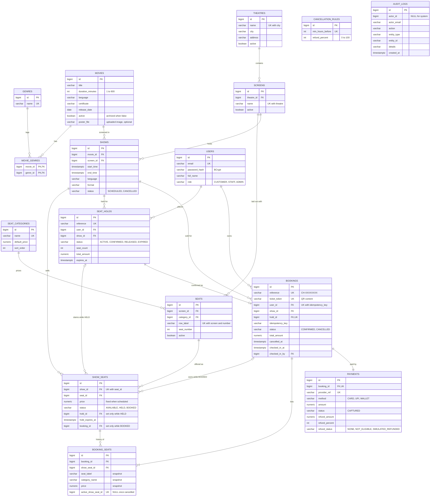

# Database schema

The schema is created by the Flyway migrations in [src/main/resources/db/migration](../src/main/resources/db/migration). A rendered copy of this diagram is at [er-diagram.png](er-diagram.png).

`CANCELLATION_RULES` and `AUDIT_LOGS` stand alone. An audit row keeps a copy of the actor and record identifiers, so it stays readable whatever later happens to those records.

## Constraints that protect the booking rules

| Constraint | What it guarantees |
|---|---|
| `show_seats UNIQUE (show_id, seat_id)` | A show has exactly one sellable row per seat. |
| `show_seats` state `CHECK` | `HELD` requires a hold and an expiry; `BOOKED` requires a booking; `AVAILABLE` allows neither. Half-applied states cannot be stored. |
| `booking_seats UNIQUE (active_show_seat_id)` | Two live bookings can never own one seat. The column is cleared on cancellation, so the seat can be resold while its history stays. |
| `bookings UNIQUE (hold_id)` | A hold can become at most one booking. |
| `bookings UNIQUE (user_id, idempotency_key)` | A retried confirmation cannot create a second booking. |
| `bookings CHECK (cancelled_at IS NULL OR checked_in_at IS NULL)` | A ticket cannot be both used and cancelled. |
| `payments UNIQUE (booking_id)`, refund `CHECK`s | One payment per booking, and a refund can never exceed the amount paid. |

Indexes cover the common lookups: shows by movie, screen and start time; show seats by status, hold and booking; holds by expiry; bookings by user, show and date; and audit rows by date, action and record.
