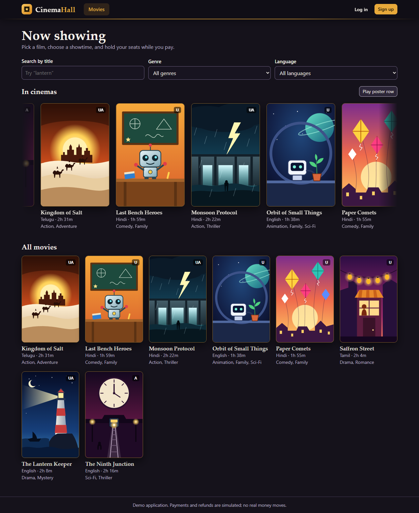
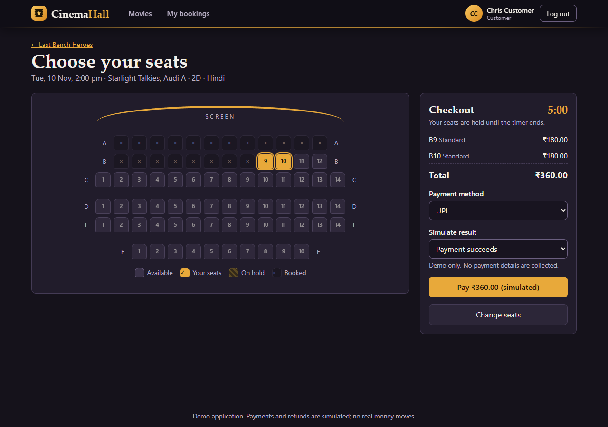
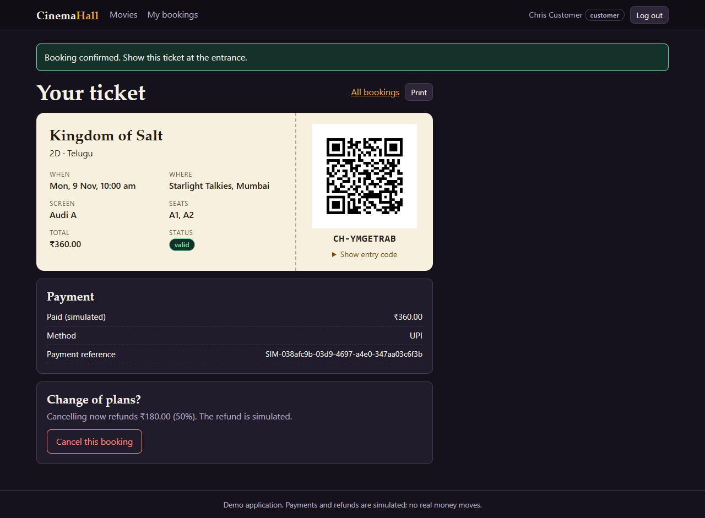
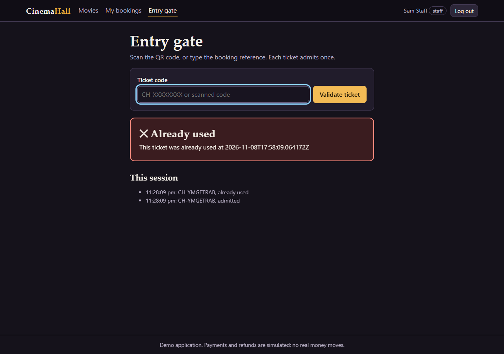
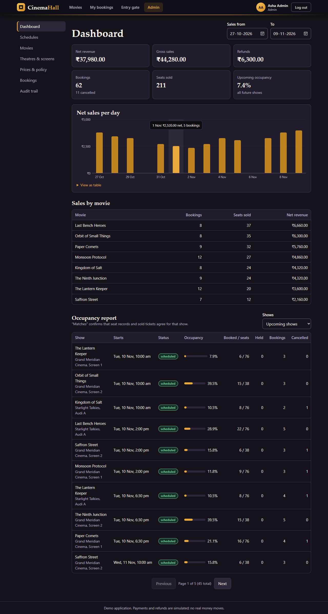
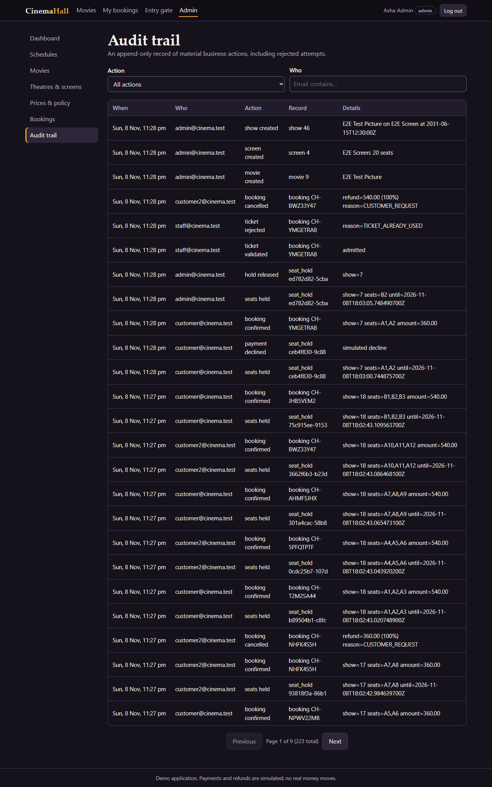

# Test evidence

Results from the runs on 8 November 2026, on Windows 11 with JDK 21.0.12. To reproduce the automated results, run the commands below.

## Automated suite

```bash
./mvnw test              # H2 in PostgreSQL mode
./mvnw test -Ppostgres   # embedded PostgreSQL 14.22
```

| Database | Tests | Failures | Errors | Skipped | Build |
|---|---:|---:|---:|---:|---|
| H2 (in memory) | 88 | 0 | 0 | 0 | SUCCESS |
| PostgreSQL 14.22 (embedded server) | 88 | 0 | 0 | 0 | SUCCESS |

| Test class | Tests | Focus |
|---|---:|---|
| `AcceptanceTest` | 19 | The five acceptance tests from the brief, including real concurrent races |
| `BookingRulesTest` | 17 | Idempotency, declined payments, ownership, refund tiers, invalid transitions, show cancellation |
| `SecurityTest` | 23 | Authentication, roles, forged tokens, login lockout, validation, error format, headers |
| `AdminOperationsTest` | 12 | Schedule overlaps, prices, catalogue integrity, layouts, policy, audit trail, search and pagination |
| `CancellationPolicyTest` | 11 | Refund boundaries and rounding (unit tests) |
| `PosterUploadTest` | 5 | Poster upload and removal, file-type checks from content, size limit, admin-only access |
| `DemoDataSeederTest` | 1 | Seed creates consistent data and is safe to run again |

## Acceptance tests

| # | Requirement | Evidence in `AcceptanceTest` |
|---|---|---|
| 1 | An available seat can be held and booked | `seatMovesFromAvailableToHeldToBooked`; `ticketHasAScannableQrImage` decodes the QR image and validates the decoded token at the gate |
| 2 | The same seat cannot be confirmed to two users | `underRealConcurrencyExactlyOneCustomerWinsTheSeat` (12 threads, exactly 1 success); `overlappingMultiSeatHoldsNeverClaimPartOfASelection`; `concurrentConfirmationsOfOneHoldCreateOneBooking`; `databaseConstraintRejectsASecondLiveOwnerEvenIfApplicationCodeIsBypassed` |
| 3 | Expired holds release the seat; confirmed bookings remain unavailable | `anExpiredHoldCannotBeConfirmed`; `anExpiredSeatIsFreeImmediatelyEvenBeforeTheSweeperRuns`; `sweeperReleasesExpiredHoldsButNeverConfirmedBookings` |
| 4 | A ticket reference or QR can be validated once | `qrTokenAdmitsOnceAndIsRejectedAfterwards`; `printedReferenceWorksAndSharesTheSameSingleUse`; `simultaneousScansAdmitExactlyOnce` (12 threads, exactly 1 admitted) |
| 5 | The occupancy report matches bookings and cancellations | `reportTracksBookingsHoldsCancellationsAndRefunds` checks the figures before and after a cancellation, then against an independent SQL count |

## Browser journeys

These ran the real application in Microsoft Edge with its Content Security Policy active, against a fresh demo database on H2. The final run of [e2e/journey.mjs](../e2e/journey.mjs) recorded **61 checks passed, 0 problems**, with no browser console errors, no uncaught script errors, no HTTP 5xx responses and no `ERROR` lines in the server log.

- **Home page:** the poster row moves left to right, Pause stops it, a poster visible in the row opens its movie, and the grid view lists every movie.
- **Customer:** browse, search, empty state, seat selection, keyboard movement, hold, refresh, declined payment, successful payment, QR ticket, history, cancellation with refund.
- **Two users:** a held seat is disabled for the other user, and the loser of a seat race gets a clear message.
- **Staff:** a ticket is admitted once and refused the second time; staff cannot open the admin UI.
- **Admin:** dashboard and chart, field-level validation errors, adding a movie, creating a screen with a layout, scheduling a show, an overlap error, and the prices, bookings and audit pages.
- **Accessibility:** 15 axe-core scans (WCAG 2 A and AA rules, including 2.1 AA) on customer, staff and admin pages found no violations. Automated scanning catches only part of accessibility, and no screen-reader session was run.
- **Phone width:** at 375 pixels, 6 pages have no horizontal page scroll.
- **API docs:** Swagger UI renders under the Content Security Policy.

[e2e/expiry.mjs](../e2e/expiry.mjs) was run against a server started with `APP_HOLD_TTL_SECONDS=8` and the real sweeper:

```text
during hold, API seat status: HELD
UI announced expiry; checkout closed: true
after expiry, API seat status: AVAILABLE
seat selectable again in UI: true
```

The server log recorded `Expired 1 overdue seat holds`.

## Other manual checks

- A clean first run with `./mvnw spring-boot:run` and the default configuration created the demo data; the home page, Swagger UI, health endpoint and an admin login all responded.
- After a restart, data persisted and the seed was skipped.

## An intermittent failure, found and resolved

A repeat run failed once in `ticketHasAScannableQrImage` with a ZXing `NotFoundException`. Ticket tokens are random, so only some tokens triggered it. A separate measurement generated 5,000 random tokens at each of two image sizes (320 and 480 pixels):

| Reading method | Failures | Wrong text |
|---|---:|---:|
| Exact-image mode (`PURE_BARCODE`) | 0 of 10,000 | 0 |
| Camera-style locator (default) | 82 of 10,000 (about 0.8%) | 0 |

A separate run found that raising the error-correction level or using `TRY_HARDER` does not remove the locator misses. The images are valid, so the test now reads them in exact-image mode, which matches what it claims to check. Whether real scanners have the same trouble is unknown, so the README lists this as a limitation. The printed reference is the fallback.

## Not tested

- The `Dockerfile` has not been built, because Docker was not available.
- The browser journeys were not run against PostgreSQL, and only Edge was used.
- No load testing was done. The concurrency tests prove correctness under contention, not throughput.
- No physical QR scanner or phone camera was tried.

## Screenshots

| | |
|---|---|
|  |  |
|  |  |
|  |  |
